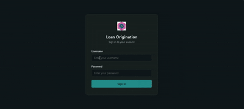

# Simulador Financeiro e Pré-Análise de Crédito (Apache Fineract LOS)



## Acesso

https://frontend-production-0e001ab8.up.railway.app

## Execução e testes

Para testar a aplicação publicada pelo navegador:
1. Acesse https://frontend-production-0e001ab8.up.railway.app
2. Na tela de login do cliente, entre com usuário `cliente` e senha `123456`
3. No menu lateral, clique em Simulator para testar o simulador e o envio dos dados para o formulário de solicitação

Observação: a rota /staff/login é destinada a funcionários internos e delega a autenticação para um servidor Apache Fineract Core externo, por isso o teste do simulador deve ser feito pelo portal do cliente.

Para rodar os testes automatizados localmente:
- Backend: ./mvnw test
- Frontend: cd frontend && npm test

Para executar localmente:
- Banco PostgreSQL na porta 5432 com banco los_db
- Backend na porta 8082: ./mvnw spring-boot:run
- Frontend na porta 4200: cd frontend && npm start

## Desenvolvedor(a) / Desenvolvedor(es/as)

Nome: Lucas Xavier Pairé 
Curso: Ciência da Computação

## Proposta

A proposta foi feita em cima de um sistema de código aberto, voltada para o fluxo de solicitação e análise de empréstimos antes da liberação do crédito.

Em comparação com os projetos anteriores desenvolvidos, que eram aplicações menores criadas do zero, este trabalho parte de uma base existente e mais complexa, com arquitetura e regras de negócio bem definidas.

A funcionalidade adicionada em cima do sistema existente é um simulador financeiro interativo com pré-análise de elegibilidade de crédito. Nela, o cliente consegue informar o valor desejado, o prazo em meses, a finalidade do empréstimo, sua renda mensal e possíveis dívidas existentes. O sistema calcula o valor da parcela, a taxa de juros conforme a finalidade, o percentual de comprometimento de renda e uma classificação de risco (baixo, moderado ou alto), permitindo levar os dados simulados diretamente para o formulário de solicitação de empréstimo.

## Desenvolvimento

### Processo

Primeiramente, tive o desafio de entender o sistema já estruturado em camadas e compreender as regras de negócio envolvidas na minha solução. Inicialmente, rodei o projeto e fui testar as páginas pelo navegador para entender como as coisas funcionavam. Por ter sistema de login, entrei no backend para saber quais eram os tipos de perfis de usuário e suas autorizações. Descobri que existiam 3 tipos de usuário: admin, staff e cliente.

Um administrador pode fazer tudo no sistema, incluindo criar contas do tipo staff e cliente. Um staff possui permissões referentes à análise da solicitação de empréstimo. Um cliente possui apenas permissões referentes a solicitar empréstimo e visualizar os dados dele.

Então, criei 2 contas que não existiam no banco, do tipo staff e cliente. Entrei na conta de cliente e quis entender os campos solicitados para fazer o empréstimo. Em paralelo, abri os DTOs referentes ao formulário de solicitação de empréstimo para entender quais dados eram obrigatórios, quais eram as validações e identificar alguma regra de negócio que pudesse ajudar a construir minha solução. Com isso, descobri que muitos campos da própria solicitação seriam reaproveitados para o simulador, o que facilitou na hora de criar os DTOs. Também descobri que o sistema já utilizava um motor de score para classificar o risco do empréstimo por meio de alguns critérios, e um deles seria usado no simulador, que é a finalidade do empréstimo (consumo, agricultura, educação, entre outros).

Com essas descobertas, notei um detalhe importante quando usei o sistema no papel de cliente: eu não conseguia ter um indicativo prévio se as informações que estava preenchendo seriam passíveis de aprovação ou não. Então pensei na solução de um simulador que pega os dados da solicitação e calcula em tempo real se aquela proposta possui condições boas, com chance de aprovação, ou condições ruins, com risco de reprovação.

Partindo para o código, foram criados os DTOs utilizando como referência os campos do próprio formulário de solicitação de empréstimo. No DTO de requisição, recebemos o valor requisitado, o prazo de parcelamento, a finalidade do empréstimo, a renda mensal do cliente e as dívidas já existentes. No DTO de resposta, entregamos o valor da parcela por mês, o valor total de juros, a taxa de juros mensal, o valor total a pagar pelo empréstimo, o percentual de comprometimento de renda, o status de elegibilidade de risco e uma mensagem recomendada do sistema.

Depois, foram criados o controller e o service para receber a requisição, validar os campos e aplicar as regras de negócio referentes ao cálculo das parcelas dessa simulação. Para isso, utilizei o método de cálculo conhecido como Tabela Price, no qual todas as parcelas possuem o mesmo valor, sendo que dentro de cada parcela há a soma entre o valor amortizado e os juros daquele mês. No começo os juros são mais altos, mas conforme os pagamentos vão avançando, os juros diminuem. Também é aplicada uma taxa de juros dinâmica conforme a finalidade do empréstimo, dividida em quatro faixas: empréstimos para consumo pessoal ou especulação possuem maior risco de inadimplência e por isso têm taxa mensal mais alta, enquanto finalidades produtivas, como agricultura ou negócios, possuem taxas menores ao mês.

Por fim, é calculado o comprometimento de renda para atribuir à simulação uma classificação de elegibilidade nos níveis de baixo risco, risco moderado e alto risco. Para isso, somam-se as dívidas atuais do cliente com o valor da nova parcela e divide-se pela renda mensal para obter uma porcentagem. Quanto maior essa porcentagem, maior é o risco. Com isso, o cliente consegue visualizar se terá condições financeiras para pagar o empréstimo. Após a simulação, também é possível enviar os valores preenchidos direto para o formulário de solicitação, poupando o cliente de ter que redigitar tudo.

Após a criação das regras de negócio e dos testes unitários para validação, foram feitos os componentes no frontend, adicionando o service para consumir as rotas do backend e a estrutura da página mantendo o padrão visual do sistema. Também foram realizados testes manuais e verificações no navegador com o Playwright MCP para garantir que a tela não apresentasse comportamentos inesperados.

No geral, o trabalho se resumiu a entender a arquitetura e as regras de negócio já existentes no sistema e aplicar os mesmos padrões de código do projeto, respeitando a responsabilidade única em cada camada.


### Trechos de código

1. Cálculo da parcela pela Tabela P rice no backend (`src/main/java/org/apache/fineract/los/service/LoanSimulationService.java`):

```java
  private BigDecimal getMonthlyInstallment(
      LoanSimulationRequest request, BigDecimal monthlyInterestRate) {
    BigDecimal compoundFactor =
        BigDecimal.ONE.add(monthlyInterestRate).pow(request.getTenorMonths());
    BigDecimal numerator = monthlyInterestRate.multiply(compoundFactor);
    BigDecimal denominator = compoundFactor.subtract(BigDecimal.ONE);
    BigDecimal installmentFactor =
        numerator.divide(denominator, CALCULATION_SCALE, RoundingMode.HALF_UP);
    return request
        .getRequestedAmount()
        .multiply(installmentFactor)
        .setScale(MONETARY_SCALE, RoundingMode.HALF_UP);
  }
```

Neste trecho, o cálculo financeiro usa `BigDecimal` com escala intermediária de 10 casas decimais (`CALCULATION_SCALE`) e arredondamento `HALF_UP`. A escolha por `BigDecimal` em vez de `double` evita erros de precisão comuns em operações monetárias com ponto flutuante.

2. Classificação de risco pelo comprometimento de renda (`src/main/java/org/apache/fineract/los/domain/enums/EligibilityRisk.java`):

```java
  public static EligibilityRisk from(BigDecimal debtToIncomeRatio) {
    if (debtToIncomeRatio.compareTo(BigDecimal.valueOf(30)) <= 0) {
      return LOW_RISK;
    }
    if (debtToIncomeRatio.compareTo(BigDecimal.valueOf(40)) <= 0) {
      return MODERATE_RISK;
    }
    return HIGH_RISK;
  }
```

Esse método centraliza as faixas de corte do comprometimento de renda. Se o comprometimento da renda ficar até 30%, o risco é baixo; entre 30% e 40%, moderado; acima de 40%, alto. Cada opção do enum também guarda a mensagem de recomendação exibida na tela.

3. Atualização reativa dos cálculos no frontend (`frontend/src/app/features/loan-simulator/loan-simulator.component.ts`):

```typescript
    this.form.valueChanges
      .pipe(
        debounceTime(300),
        distinctUntilChanged((prev, curr) => JSON.stringify(prev) === JSON.stringify(curr)),
        filter(() => this.form.valid),
        switchMap((value) => {
          this.loading.set(true);
          this.error.set(null);
          return this.simulationService.simulate(value as unknown as LoanSimulationRequest).pipe(
            catchError((err) => {
              this.loading.set(false);
              this.error.set(
                err?.error?.message ?? 'Could not calculate simulation. Please check your inputs.',
              );
              return EMPTY;
            }),
          );
        }),
        takeUntilDestroyed(),
      )
```

Esse trecho escuta as mudanças do formulário e aplica `debounceTime(300)` para esperar 300ms antes de chamar a API, evitando requisições a cada movimento do slider. O `switchMap` cancela requisições anteriores pendentes caso o usuário altere os valores rapidamente, evitando que respostas antigas sobrescrevam resultados mais novos.

## Tecnologias

### Linguagens e afins

- Java 21 e Spring Boot 4.1
- TypeScript e Angular 22
- HTML5 e SCSS
- PostgreSQL 15 e Flyway
- JUnit 5 e PLaywright

### Ambiente de desenvolvimento

- IntelliJ IDEA para execução e depuração do backend e frontend
- Git e GitHub para controle de versão
- Antigravity como agente de IA de apoio no desenvolvimento e nos testes

## Referências e créditos

- Repositório base Apache Fineract Loan Origination: https://github.com/apache/fineract-loan-origination

---
Projeto entregue para a disciplina de [Desenvolvimento de Software para a Web](http://github.com/andreainfufsm/elc1090-2026b) em 2026b